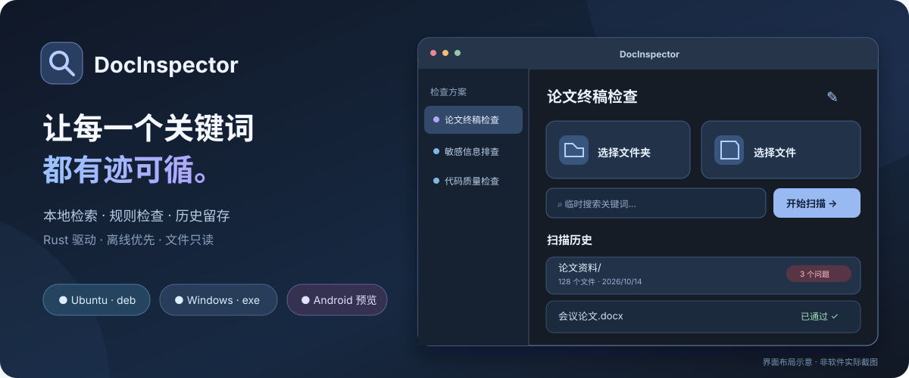

<div align="center">



<br>

[](https://github.com/lbg2002/DocInspector/releases/latest)
[](https://github.com/lbg2002/DocInspector/actions/workflows/build.yml)


**轻量 · 离线 · 不修改原文件**

[**⬇️ 下载正式版**](https://github.com/lbg2002/DocInspector/releases/latest)　·　[📖 使用指南](#-三步开始检查)　·　[🧩 检查方案](#-自定义方案)　·　[🛠️ 参与开发](#-本地开发)

</div>

---

## ✨ 一眼认识 DocInspector

**一个适合论文、报告、代码项目的本地关键词检查器。**

不用建立数据库、无需上传云端、更不需要配置大模型。选择文件夹或任意文件，检查指定词语是否**出现、禁止出现、必须出现**，快速定位原文并保存扫描历史。

| 🎯 **自定义方案** | ⚡ **Rust 快速扫描** | 🔍 **证据可追溯** |
| :--- | :--- | :--- |
| 自己命名，保存和复用关键词规则 | 多关键词一次匹配、有限并发、支持取消 | 文件路径、行号 / 页码、上下文高亮 |
| 🗂️ **文件夹递归** | 🧹 **智能过滤** | 🕘 **扫描历史** |
| 文件夹递归或多文件选择 | 可跳过 .git、node_modules、缓存目录 | 按方案查看历史结果、再次打开详情 |

## 🚀 三步开始检查


1. 在**左侧方案列表**选择已有方案，或点击 `+` 新建一个方案。
2. 在右侧选择**文件夹**（自动递归）或**多个文件**，点击 **开始扫描**。
3. 在结果页筛选问题、查看关键词高亮；需要时**导出 CSV**，以后也能从该方案的扫描历史重新打开。

### 📦 安装与下载

**[→ GitHub Releases · 最新正式版](https://github.com/lbg2002/DocInspector/releases/latest)**

| 适用平台 | 下载什么 | 如何安装 |
| :--- | :--- | :--- |
|  **Ubuntu / Linux amd64** | `.deb` | 在下载目录执行 `sudo apt install ./*.deb` |
|  **Windows 10 / 11 x64** | `-setup.exe` | 双击安装器（依赖系统 WebView2） |
| 📱 **Android ARM64** | 调试预览 APK | [从 Actions 体验预览版](https://github.com/lbg2002/DocInspector/actions/workflows/android.yml)，不属于桌面正式 Release |

> Ubuntu 版使用系统 WebKitGTK，**不额外打包约 80 MB 的 AppImage**。不同系统安装包体积会有所不同。

## 🧩 自定义方案

最常用的操作是创建并保存一套规则。比如一份论文交付前的检查方案：

| 检查类型 | 示例关键词 | 检查结果 |
| :--- | :--- | :--- |
| ⛔ **禁止出现** | `TODO`、`待补充`、`占位符` | 出现时标记为问题 |
| ✅ **必须包含** | `摘要`、`参考文献` | 每个文件缺少时标记为问题 |
| 🔎 **仅检索** | `轨道机动`、`意图识别` | 只记录位置，不判定违规 |

方案支持**创建、编辑、复制、删除和 JSON 导入/导出**。每套方案都可以单独设置匹配方式：

- **区分大小写**：默认开启；关闭后忽略 ASCII 英文字母大小写。
- **完整单词匹配**：用于避免英文词命中较长标识符。
- **忽略缓存目录**：默认跳过 `.git`、`node_modules`、`target`、`.venv`、`dist` 等。
- **自定义排除目录**：输入需要忽略的目录名称，多个名称用逗号分隔。

扫描完成后，结果区支持**文件名/关键词即时筛选、拖动双栏宽度、双击打开文件、右键打开所在目录、复制路径**。

## 📚 支持的文件类型

| 类型 | 主要格式 | 结果定位 |
| :--- | :--- | :--- |
| 📄 文档 | PDF、DOCX、PPTX | PDF 页码 / Office 文档结构 |
| 📊 表格 | XLSX、XLS、ODS、CSV | 工作表及单元格 / 行 |
| 📝 纯文本 | TXT、MD、LOG、JSON、XML、HTML、YAML、TOML | 行号 |
| 💻 源代码 | **PY、RS**、JS、TS、TSX、C、CPP、H、Java、Go、SQL、Shell、TeX 等 | 行号 |

普通文本与代码支持跨行检索；文档从可提取文本中进行检查。**扫描件 PDF 尚不支持 OCR**，复杂嵌入对象、无法读取的内容不会被当作已通过。

## 🪶 为什么轻量？

`Rust` 负责实际文件读取、规则判定和多关键词匹配；`Tauri 2 + Svelte` 负责桌面交互。依赖系统 WebView，不需要打包完整浏览器。


核心测试覆盖重叠关键词、跨行搜索、大小写、单词边界、文件过滤和命中上限。桌面版本在 GitHub Actions 中先测试，再打包 Ubuntu `.deb` 和 Windows `.exe`。

## 🛠️ 本地开发

需要 Node.js 22+、Rust stable，以及 [Tauri 2 的平台依赖](https://v2.tauri.app/start/prerequisites/)。

```bash
git clone https://github.com/lbg2002/DocInspector.git
cd DocInspector

npm install
npm run tauri dev

# Rust 核心测试
cargo test --manifest-path src-tauri/Cargo.toml --lib

# Ubuntu 发布构建
npm run tauri build -- --bundles deb
```

## 💬 使用说明与计划

- **本地优先**：文件无需上传，也不会因扫描被修改。
- **历史记录**：保存有限数量的命中证据；完整留档请在扫描后导出 CSV。
- **Android 预览**：支持系统多文件选择，暂不支持通过标准对话框递归选择目录；部分 `content://` 文档提供方仍需真机验证。
- **后续方向**：增量索引、可选 OCR、更完整的 Unicode 匹配，而不是让基础软件臃肿。

欢迎在 [Issues](https://github.com/lbg2002/DocInspector/issues) 中反馈问题或提出建议。

---

<div align="center">
  <sub>Built with ❤️ · Rust × Tauri × Svelte · Assisted by GPT-6</sub>
</div>
